# Kudosly

**Kudosly** is a multi-tenant SaaS web application for collecting, moderating
and publishing customer testimonials. An account holder creates a *space* — a
branded collection page — shares its public URL, and receives testimonials
from their own customers. Approved testimonials can then be published as a
shareable *Wall of Love* or embedded on any website as a live widget.

Built with Laravel 13, Livewire 4, Tailwind CSS 4 and Laravel Cashier.

> **Status: feature-complete for its defined scope.**
> Development covered the planned build phases for this application. The
> application is **not production-ready** — see
> [Known Limitations and Remaining Work](#known-limitations-and-remaining-work)
> for the security, deployment and performance items that remain outstanding.

Repository: <https://github.com/Farha-Musharrat-Monira/kudosly>
Branch: `main` · 7 commits · 18 migrations · 660 tests passing

---

## Table of Contents

- [Project Overview](#project-overview)
- [Quick Start](#quick-start)
- [Features Summary](#features-summary)
- [Demo](#demo)
- [Technology Stack](#technology-stack)
- [Prerequisites](#prerequisites)
- [Installation](#installation)
- [Environment Configuration](#environment-configuration)
- [Database Setup](#database-setup)
- [Running the Application](#running-the-application)
- [Running the Tests](#running-the-tests)
- [Feature Status](#feature-status)
- [Agentic Development Tooling](#agentic-development-tooling)
- [Known Limitations and Remaining Work](#known-limitations-and-remaining-work)
- [Screenshots](#screenshots)
- [Project Purpose](#project-purpose)

---

## Project Overview

Kudosly is a server-rendered Laravel application with a Livewire front end.
Every authenticated screen is a Livewire component, so the dashboard updates
without a full page reload, while the public pages (collection form, Wall of
Love, embedded widget) are plain Blade views with no JavaScript framework.

### Core concepts

| Concept | Description |
| --- | --- |
| **Account** | A `User`. Owns spaces, testimonials and widgets, and holds a plan. |
| **Space** | A branded testimonial collection page with its own slug, theme and custom fields. Public URL at `/s/{slug}`. |
| **Space field** | A custom question on a space's collection form (e.g. *"What do you like most about us?"*). Fields are ordered by the owner. |
| **Testimonial** | A customer submission against a space. Carries a status (`pending`, `approved`, `hidden`), a heart flag for the Wall of Love, and explicit sharing consent. |
| **Widget** | An embeddable presentation of a space's testimonials, with its own public identifier, layout, theme and display limit. |
| **Plan** | An entitlement tier (`Free`, `Pro`) fixing how many spaces and testimonials an account may hold. |

### Public surface

| Route | Purpose | Access |
| --- | --- | --- |
| `GET /s/{slug}` | Reserved public space URL. | Public |
| `GET /s/{slug}/submit` | Live collection form. | Public |
| `POST /s/{slug}/submit` | Testimonial submission endpoint. | Public, CSRF + honeypot + rate limited |
| `GET /s/{slug}/thank-you` | Post-submission confirmation. | Public |
| `GET /wall/{slug}` | Public Wall of Love. | Public |
| `GET /w/{publicId}` | Standalone widget page. | Public |
| `GET /widget/{publicId}/embed` | Embeddable widget fragment (iframe target). | Public, cross-origin readable |
| `POST /stripe/webhook` | Stripe subscription events. | Public, signature verified |

---

## Quick Start

```bash
git clone https://github.com/Farha-Musharrat-Monira/kudosly.git
cd kudosly
composer install
cp .env.example .env
php artisan key:generate
touch database/database.sqlite     # create the SQLite file — see note below
php artisan migrate --seed
npm install && npm run build
php artisan serve
```

Open <http://127.0.0.1:8000>. Health check: `/up`.

**SQLite note.** `database/database.sqlite` is git-ignored
(`database/.gitignore` → `*.sqlite*`), so it is **not** present in a fresh
clone. The `touch` step is listed explicitly so the prerequisite is
unambiguous. Laravel's SQLite driver creates the file on connect, so
`php artisan migrate` will also succeed without it — but creating it up front
makes the setup deterministic and matches the documented intent.

Windows PowerShell equivalent for the platform-specific commands:

```powershell
Copy-Item .env.example .env
New-Item -ItemType File -Path database/database.sqlite
```

In a second terminal, start the frontend dev server:

```bash
npm run dev
```

Full setup instructions, including every optional dependency, are in
[Installation](#installation).

---

## Features Summary

| ✅ | ⚠️ Partial |
| --- | --- |
| Authentication (register, login, reset, verification, profile, password) | Widget embeds — working, but not container-query based |
| Account dashboard with plan usage meters | Public Wall of Love — works, but the query is unbounded |
| Space management with custom ordered fields | Settings — profile and password only |
| Free and Pro plan limits, enforced | Dashboard — two icons referenced but not defined |
| Public testimonial collection form (CSRF, honeypot, rate limited) | Billing — webhook-synced only, no reconciliation |
| Moderation inbox: approve, hide, heart, delete, search, filter | |
| Private testimonial photos, owner-only streaming | |
| Public Wall of Love with consent enforcement | |
| Embeddable widgets: masonry/carousel, themes, live preview, iframe + `<script>` | |
| Stripe billing: Checkout, Customer Portal, cancel at period end | |
| Stripe webhooks with signature verification and idempotency | |
| Cross-account authorization policies | |
| Email verification control (on in production, off in local) | |
| Trusted proxy handling | |

See [Feature Status](#feature-status) for the detailed breakdown.

---

## Demo

**A recorded demo has not yet been produced.** The following walkthrough
describes the intended demonstration path.

No screenshots or video are included in this repository at the time of
writing — see [Screenshots](#screenshots) for the planned capture list.

### Suggested walkthrough

1. **Register** an account at `/register`. In local development email
   verification is skipped (`KUDOSLY_REQUIRE_EMAIL_VERIFICATION=false`), so
   the dashboard is reachable immediately. In production the verification
   notice appears and the account must verify first.
2. **Dashboard** — shows the plan (Free), space usage against the 3-space
   quota, and testimonial usage against the 100-per-space quota.
3. **Create a space** — name it, choose a theme, and add custom fields, for
   example *"What do you like most about us?"*. The space receives a unique
   slug; publishing is toggled from the space list.
4. **Copy the public URL** — the collection form lives at
   `/s/{slug}/submit`.
5. **Submit a testimonial** — open the collection URL in a private window
   (no account needed). The form renders the space's custom fields. Submitting
   shows the thank-you page. The submission lands in the Inbox as `pending`.
6. **Moderate** — in the Inbox, approve the testimonial, then heart it. A
   testimonial must be both approved and hearted to appear publicly.
7. **Wall of Love** — open `/wall/{slug}`. The testimonial appears with its
   public content only: no customer email address and no customer photograph
   are exposed.
8. **Widgets** — open `/widgets`, create a widget for the space, choose a
   layout (masonry or carousel) and theme (light or dark), and watch the live
   preview update. Copy the iframe snippet or the `<script>` snippet.
9. **Embed** — paste the snippet into any HTML page. The loader fetches the
   fragment from its own origin and injects it into the host page.
10. **Billing** — open `/billing` to see plan state and usage. With Stripe
    test keys and a `STRIPE_PRICE_PRO` value configured, upgrading starts a
    Stripe Checkout session; the Customer Portal manages the subscription.
11. **Webhook** — with Stripe CLI forwarding events to
    `http://127.0.0.1:8000/stripe/webhook`, the subscription state in
    `/billing` updates automatically.

---

## Technology Stack

### Backend

| Technology | Version | Purpose |
| --- | --- | --- |
| PHP | 8.3+ (developed on 8.5.12) | Runtime. |
| Laravel | ^13.17 | Application framework. |
| Laravel Fortify | ^1.43 | Authentication scaffolding: registration, login, password reset, profile and password management. |
| Laravel Cashier | ^16.11 | Stripe subscriptions, Checkout, Customer Portal and webhook handling. |
| Livewire | ^4.4 | Reactive front-end components for all authenticated screens. |
| stripe/stripe-php | ^18.0 | Stripe API client. |

### Frontend

| Technology | Version | Purpose |
| --- | --- | --- |
| Tailwind CSS | ^4.0 | Utility-first styling, via the Vite plugin. |
| Vite | ^8.0 | Asset bundler and dev server. |
| laravel-vite-plugin | ^3.1 | Laravel integration for Vite. |
| Bunny Fonts | via plugin | Self-hosted "Instrument Sans" (400/500/600). |

The public widget loader (`public/widget.js`) is dependency-free, hand-written
vanilla JavaScript.

### Testing and tooling

| Tool | Version | Purpose |
| --- | --- | --- |
| Pest | ^5.3 | Test framework and runner. |
| pest-plugin-laravel | ^5.0 | Laravel helpers for Pest (HTTP testing, database traits). |
| pest-plugin-livewire | ^5.0 | Livewire component testing for Pest. |
| Laravel Pint | ^1.27 | Code style formatter (PSR-12 based). |
| Mockery | ^1.6 | Mocking, used by the Stripe test doubles. |
| Laravel Boost | ^2.2 | AI agent guidelines and an MCP server. |
| Laravel Pao | ^1.0.6 | Dev process orchestration (`php artisan dev`). |

### Data

| Technology | Purpose |
| --- | --- |
| SQLite | Default local database (`database/database.sqlite`). |
| Eloquent ORM | Data access, with 18 migrations covering users, plans, spaces, space fields, testimonials, widgets, Stripe subscriptions, subscription items and processed webhook events. |

---

## Prerequisites

| Requirement | Version | Notes |
| --- | --- | --- |
| PHP | 8.3 or newer | Must have `pdo_sqlite`, `mbstring`, `openssl`, `tokenizer`, `xml`, `ctype`, `json`, `fileinfo` and `curl`. |
| Composer | 2.x | Dependency manager. |
| Node.js | 20 or newer | With npm. Required to build frontend assets. |
| Stripe CLI | optional | Only needed to forward live Stripe webhooks to a local machine. |
| SQLite | bundled with PHP | No separate database server is needed for local development. |

> **Windows note.** The project was developed on Windows with
> [Laravel Herd](https://herd.laravel.com). `php` is not on the system `PATH`
> by default there; use the Herd binary directly, for example
> `C:/Users/<user>/.config/herd/bin/php85/php.exe`, or add Herd's bin
> directory to `PATH`.

> **macOS / Linux note.** If PHP and Composer are not installed, the
> `AGENTS.md` / `CLAUDE.md` guidelines in this repository record the
> documented one-liner install path:
> `/bin/bash -c "$(curl -fsSL https://php.new/install/mac/8.5)"` on macOS and
> `/bin/bash -c "$(curl -fsSL https://php.new/install/linux/8.5)"` on Linux.
> Restart your terminal afterwards.

---

## Installation

Clone the repository and install the PHP dependencies:

```bash
git clone https://github.com/Farha-Musharrat-Monira/kudosly.git
cd kudosly
composer install
```

Create the environment file and generate an application key:

```bash
cp .env.example .env        # macOS / Linux
Copy-Item .env.example .env # Windows PowerShell

php artisan key:generate
```

Create the SQLite database file. This file is git-ignored and is therefore
**absent from a fresh clone**:

```bash
touch database/database.sqlite     # macOS / Linux
New-Item -ItemType File -Path database/database.sqlite  # Windows PowerShell
```

Run the migrations and seed the plan catalog:

```bash
php artisan migrate
php artisan db:seed
```

> The `plans` table is also seeded by a migration
> (`2026_01_01_000105_seed_plans_table.php`), so a fresh install always has
> the `Free` and `Pro` rows. `db:seed` re-syncs them with
> `app/Support/PlanCatalog.php`, which is the single source of truth for plan
> limits and pricing.

Install the frontend dependencies and build the assets:

```bash
npm install
npm run build
```

### One-command setup script

`composer.json` defines a `setup` script that performs the equivalent steps in
one command:

```bash
composer run setup
```

It runs `composer install`, copies `.env.example` to `.env` if missing, runs
`key:generate`, runs `migrate --force`, installs npm packages and builds the
frontend.

**Prerequisite:** the `setup` script does **not** create
`database/database.sqlite`. It relies on the SQLite driver creating the file
on first connect. Creating the file explicitly first, as shown above, is
recommended so the setup is deterministic.

---

## Environment Configuration

Configuration lives in `.env`. **`.env` is git-ignored and is never
committed.** `.env.example` is the tracked template and contains no
credentials — every secret is an empty placeholder.

```bash
cp .env.example .env
```

### Application

| Variable | Default | Purpose |
| --- | --- | --- |
| `APP_NAME` | `Kudosly` | Display name used in the UI and in emails. |
| `APP_ENV` | `local` | `local`, `testing` or `production`. |
| `APP_KEY` | *(generated)* | Encryption key. Set by `php artisan key:generate`. |
| `APP_DEBUG` | `true` | **Must be `false` in production** — a debug build prints stack traces and configuration values, including secrets. |
| `APP_URL` | `http://localhost:8000` | Canonical application URL, used when building links. |
| `APP_LOCALE` / `APP_FALLBACK_LOCALE` | `en` | Interface language. |

### Database

| Variable | Default | Purpose |
| --- | --- | --- |
| `DB_CONNECTION` | `sqlite` | Database driver. |
| `DB_DATABASE` | *(SQLite file)* | Path to the SQLite file, or the database name for MySQL/PostgreSQL. |

### Kudosly-specific settings

| Variable | Default | Purpose |
| --- | --- | --- |
| `KUDOSLY_REQUIRE_EMAIL_VERIFICATION` | `true` | Whether a new account must verify its email address before reaching the dashboard. Set to `false` **only for local development**. |
| `TRUSTED_PROXIES` | *(empty)* | Comma-separated list of proxy addresses whose forwarded headers may be trusted. Leave empty unless the application genuinely sits behind a proxy — an untrusted header must never be honoured, or a visitor could forge the address that the rate limiters key on. A wildcard (`*`) is rejected. |
| `KUDOSLY_WALL_DISPLAY_LIMIT` | `100` | Maximum number of testimonials shown on a public Wall of Love. |

### Stripe

| Variable | Default | Purpose |
| --- | --- | --- |
| `STRIPE_KEY` | *(empty)* | Stripe publishable key. |
| `STRIPE_SECRET` | *(empty)* | Stripe secret key. Use a **test-mode** key during development. |
| `STRIPE_WEBHOOK_SECRET` | *(empty)* | Signing secret of the webhook endpoint. The endpoint stays closed (`403`) while this is empty, because an unsigned payload cannot be distinguished from a forged one. |
| `STRIPE_PRICE_PRO` | *(empty)* | Stripe Price ID for the Pro plan. Entitlement checks compare the subscription's price against this value. |
| `CASHIER_CURRENCY` | `usd` | Currency used by Cashier. |

### Mail, cache, session and queue

| Variable | Default | Notes |
| --- | --- | --- |
| `MAIL_MAILER` | `log` | The `log` mailer writes messages to the log file and sends nothing. Production must use a real transport, or password reset and verification emails never arrive. |
| `SESSION_DRIVER` | `database` | Production must set `SESSION_SECURE_COOKIE=true` so the session cookie is only sent over an encrypted connection. |
| `SESSION_SAME_SITE` | *(unset)* | Set to `lax` in production. |
| `CACHE_STORE` | `database` | |
| `QUEUE_CONNECTION` | `database` | |
| `LOG_LEVEL` / `LOG_STACK` | `debug` / `single` | Production should use `info` and `stderr` so logs reach the platform's collector instead of a file. |

### Production checklist

This checklist records the production requirements the code documents. **None
of it is enforced automatically at boot** — each item must be applied and
verified by hand.

- [ ] `APP_ENV=production`
- [ ] `APP_DEBUG=false`
- [ ] `SESSION_SECURE_COOKIE=true`, `SESSION_SAME_SITE=lax`
- [ ] `MAIL_MAILER` set to a real transport
- [ ] `LOG_LEVEL=info`, `LOG_STACK=stderr`
- [ ] `TRUSTED_PROXIES` set to the real load balancer / CDN addresses
- [ ] `STRIPE_SECRET`, `STRIPE_WEBHOOK_SECRET` and `STRIPE_PRICE_PRO` set to **live** values
- [ ] `php artisan config:cache` and `php artisan route:cache` re-run after every configuration change

---

## Database Setup

Kudosly uses SQLite locally. The database file lives at
`database/database.sqlite` and is covered by `database/.gitignore`
(`*.sqlite*`), so it is never committed.

```bash
# Create the database file (required on a fresh clone)
touch database/database.sqlite

# Run all migrations
php artisan migrate

# Run migrations and seed the plan catalog
php artisan migrate --seed

# Inspect the current state
php artisan migrate:status

# Roll back the last batch
php artisan migrate:rollback
```

**Migrations.** 18 migrations are applied on a fresh install, covering the
users, cache and jobs tables, plans, spaces, space fields, testimonials,
optional testimonial fields, Stripe customer columns, subscriptions,
subscription items, metered-billing columns, billing email, processed webhook
events and widgets.

**Seeding.** `database/seeders/DatabaseSeeder.php` creates the `Free` and
`Pro` plan rows using `updateOrCreate`, so running it repeatedly is safe.

**Factories.** Six model factories are available for generating test data:
`UserFactory`, `PlanFactory`, `SpaceFactory`, `SpaceFieldFactory`,
`TestimonialFactory` and `WidgetFactory`.

> ⚠️ `migrate:fresh`, `migrate:refresh` and `db:wipe` **drop every table**.
> Never run them against a database that holds data you want to keep.

### Plan limits

Plan limits are defined once in `app/Support/PlanCatalog.php` and seeded into
the `plans` table, so the limits a customer is charged against can never drift
from the limits quoted in the interface.

| Plan | Price | Max spaces | Max testimonials per space |
| --- | --- | --- | --- |
| Free | $0 | 3 | 100 |
| Pro | $999.00 USD / month | 25 | 1,000 |

An account's effective plan comes from `User::effectivePlan()`, which returns
the Pro plan when the account holds an active (or grace-period) subscription
whose price matches `STRIPE_PRICE_PRO`, and the Free plan otherwise.

---

## Running the Application

### Backend

```bash
php artisan serve
```

The application is then available at <http://127.0.0.1:8000>. The health check
endpoint is at `/up`.

### Frontend

In a second terminal:

```bash
npm run dev
```

This starts the Vite dev server with hot module replacement. Laravel's
`laravel-vite-plugin` reads the dev-server address from `public/hot`.

### Both together

`laravel/pao` provides a `dev` command that runs the PHP server, the Vite
dev server and the log tail together:

```bash
php artisan dev
```

Useful options: `--tabs` for tabbed output, `--stream` for stream mode,
`--inline` to print plain output instead of the TUI, and `php artisan
dev:list` to see the registered processes.

### Production build

```bash
npm run build
php artisan config:cache
php artisan route:cache
php artisan view:cache
```

---

## Running the Tests

The suite is written with Pest and runs against an **in-memory SQLite**
database. `phpunit.xml` pins the environment variables the suite depends on,
so results never change with the contents of a developer's local `.env`.

```bash
# Run the whole suite
php vendor/bin/pest

# Equivalent, via the framework
php artisan test

# Run a single file
php vendor/bin/pest tests/Feature/Billing/WebhookTest.php

# Run a single test by name
php vendor/bin/pest --filter="redirects an unverified account"

# Filter by test suite
php vendor/bin/pest --testsuite=Feature
```

**Current verified result: 660 tests passing, 1,872 assertions.**

### Test layout

| Directory | Contents |
| --- | --- |
| `tests/Feature/Auth/` | Registration, login, password reset, profile, email verification (local vs. production), trusted proxy handling. |
| `tests/Feature/Authorization/` | Space ownership policies. |
| `tests/Feature/Billing/` | Checkout, Customer Portal, entitlement rules, webhook processing. |
| `tests/Feature/` | Dashboard, spaces, moderation, wall, widgets, plan limits, public submission. |
| `tests/Unit/` | Unit tests. |
| `tests/Support/` | Stripe test doubles: `FakeStripeClient`, `FakeSubscriptionService`, `FakeCheckoutSessionService`, `FakeCheckoutService`, `FakeCustomerService`, `FakeBillingPortalService`, `FakeBillingPortalSessionService`, `StripeWebhook`. |

No test contacts the live Stripe API. Stripe interactions are faked through the
support doubles above.

### Code style

```bash
# Check style without changing files
php vendor/bin/pint --test

# Apply the fixes
php vendor/bin/pint
```

**Current verified result: PASS — 133 files.**

---

## Feature Status

### ✅ Completed and tested

| Feature | Implementation | Coverage |
| --- | --- | --- |
| **Authentication** | Laravel Fortify: registration, login, logout, password reset, email verification, profile update, password change. | `tests/Feature/Auth/` (9 files) |
| **Account dashboard** | Livewire `Dashboard\Overview` with usage meters against the plan quotas. | `tests/Feature/DashboardTest.php` |
| **Space management** | Create, edit and delete spaces; custom ordered fields; publish / unpublish; unique slug generation with collision retry; delete confirmation. | `SpaceManagementTest.php`, `SpaceDetailTest.php`, `SpacePublishTest.php`, `SlugGenerationTest.php` |
| **Plan limits** | Free and Pro quotas enforced on spaces and testimonials, sourced from `PlanCatalog`. | `PlanLimitTest.php` |
| **Testimonial collection** | Public form with per-space custom fields, validation, honeypot, CSRF and per-space + per-IP rate limiting (5/minute). | `PublicTestimonialSubmissionTest.php` |
| **Moderation inbox** | Livewire `Inbox\ManageTestimonials`: approve, hide, unhide, heart, unheart, delete with confirmation, search and filters. | `InboxTest.php`, `TestimonialModerationTest.php` |
| **Testimonial photos** | Photos stored on a private disk and streamed to the space owner only through an authorised route. | `TestimonialPhotoTest.php` |
| **Wall of Love** | Public wall at `/wall/{slug}` showing only hearted **and** publicly visible testimonials. Unpublished spaces return a generic notice that leaks nothing. | `PublicWallTest.php`, `WallManagementTest.php` |
| **Embeddable widgets** | One widget per space with a 32-character public id (collision retry), masonry/carousel layouts, light/dark themes, background colour picker, display limit (1–50), live preview, iframe and `<script>` snippets. | `WidgetManagementTest.php`, `PublicWidgetEmbedTest.php`, `WidgetCrossOriginEmbedTest.php` |
| **Stripe billing** | Checkout session, Customer Portal, cancel-at-period-end, plan display, entitlement resolution through `User::effectivePlan()`. | `BillingManagementTest.php`, `CheckoutTest.php`, `EntitlementTest.php` |
| **Stripe webhooks** | Signature verification via Cashier, idempotent event claiming through the `stripe_webhook_events` table, handling of subscription created / updated / deleted. | `WebhookTest.php` |
| **Authorization** | `SpacePolicy` and `WidgetPolicy` prevent cross-account access. | `SpacePolicyTest.php` |
| **Email verification control** | `KUDOSLY_REQUIRE_EMAIL_VERIFICATION` keeps verification mandatory in production and skips it in local development. | `LocalEmailVerificationTest.php`, `ProductionEmailVerificationTest.php`, `EmailVerificationSettingTest.php` |
| **Trusted proxy handling** | `TRUSTED_PROXIES` is parsed in `AppServiceProvider::boot()` and applied through Laravel's `TrustProxies::at()`. Empty values trust nothing; a wildcard is rejected. | `TrustedProxiesTest.php` |
| **Production configuration template** | `.env.example` documents the production requirements for `APP_DEBUG`, secure cookies, mail transport, logging and trusted proxies. | — |

### ⚠️ Partially completed

| Feature | What works | What is missing |
| --- | --- | --- |
| **Billing schedule and reconciliation** | The webhook is the only path that synchronises subscription state, and it handles the events Stripe delivers. | No scheduled reconciliation command exists, so a **missed `customer.subscription.deleted` webhook leaves an account with permanent Pro access**. No `cashier:schedule` command ships with Cashier 16.11, so a bespoke command is required. |
| **Widget embeds** | The standalone widget page, the iframe fragment and the vanilla-JS loader all work and are tested. | Layout is not container-query based, so widget responsiveness relies on fixed breakpoints rather than the host container's width. Accessibility refinements for embedded content are outstanding. |
| **Public Wall of Love** | The wall renders, filters correctly and hides unpublished spaces. | The query has **no row limit**, so a space with a very large number of hearted testimonials loads them all. A `KUDOSLY_WALL_DISPLAY_LIMIT` setting exists in `config/kudosly.php` but is not yet applied to the query. |
| **Settings** | The profile form and password form save through the Fortify action classes. | The page is served by `PlaceholderController`; the wider settings area (billing email, notification preferences) is not built. |
| **Dashboard** | The overview shows usage meters and plan state. | The `eye-off` and `chart` icons referenced by the inbox and stat-card components are **not defined** in `resources/views/components/icon.blade.php`, so they silently fall back to the generic circle icon. |

### ❌ Out of scope for this build

The following were never part of the planned build and remain unimplemented.
They are listed for completeness, not as pending work.

| Item | Notes |
| --- | --- |
| **Multi-currency / usage-based billing** | The `subscription_items` table carries `meter_id` and `meter_event_name` columns, but no metering logic is implemented. |
| **Internationalisation** | Only English is implemented. |
| **Deployment and CI configuration** | No CI workflow, no production deployment scripts, no `docker` / `Procfile` setup. |
| **API** | No public REST or GraphQL API; the application is server-rendered only. |

---

## Agentic Development Tooling

This project was developed with the help of AI coding assistants. The
distinction between what was **actively used** and what is merely
**installed and available** is drawn deliberately below, so that no tool is
credited with work it did not do.

### Actively used — PUKU CLI

PUKU CLI was the primary AI coding assistant used throughout development,
running in the terminal against this working directory.

- **Evidence of use:** `.puku-cli/settings.local.json` exists in the project
  (git-ignored via `/.puku-cli/` in `.gitignore`) and contains a recorded
  per-project permission allow-list. This directory is created and maintained
  by the tool itself.
- **Work performed with it:** the feature-by-feature implementation of the
  product; running and triaging the Pest suite; executing Laravel Pint; and
  the production-hardening work — the explicit email-verification
  configuration, the `.env.example` hardening, the trusted-proxy handling,
  and the Cashier scheduling and reconciliation audit.
- **Working method:** the assistant was given explicit scope boundaries and
  required to demonstrate each change with tests before treating it as done.
  For example, it was instructed to prohibit modifications to `.env`,
  `PRD.md`, the SQLite database and backups, to forbid any command touching
  the live Stripe API, and to report failures honestly rather than
  weakening a test to make it pass.
- **One outcome worth noting:** the reconciliation command design was
  drafted and then **twice rejected** during review, and the implementation
  was deliberately left unimplemented rather than shipped half-finished.
  That work is still open — see
  [Known Limitations](#known-limitations-and-remaining-work).

### Installed and available — Laravel Boost

Laravel Boost is installed as a **dev dependency** (`laravel/boost: ^2.2`).
Its commands are registered in this application.

- **Guidelines files:** `CLAUDE.md` and `AGENTS.md` at the repository root
  carry identical `<laravel-boost-guidelines>` content, so the project can be
  opened by any agent that reads either file.
- **What the guidelines cover:** the PHP and Composer prerequisites, the
  per-OS PHP install commands, and the instruction to run
  `php artisan boost:install` before making application changes.
- **MCP command available:** `php artisan boost:mcp` starts the Boost MCP
  server, alongside `boost:list-skills`, `boost:add-skill`,
  `boost:index-rules` and `boost:update`.
- **State of use:** Boost is installed as a dependency and its commands are
  registered, but `php artisan boost:install` has **not** been run in this
  repository — there is no `.ai/` rules directory and no `.claude/skills/`
  directory. The shipped `CLAUDE.md` / `AGENTS.md` files are still the stock
  Boost bootstrap guidelines. Boost is therefore **available**, not
  demonstrably in active use as a rules source.

### Installed and available — Laravel Pao

`laravel/pao` is installed as a dev dependency and provides `php artisan dev`,
which runs the PHP server, the Vite dev server and the log tail together
(`--tabs`, `--stream`, `--inline`), plus `php artisan dev:list` to inspect
the registered processes. This is a development convenience rather than an
AI integration.

### Not verified as actively used

The following are **not** claimed for this project, because there is no
evidence of them in the repository:

- **Claude Code skills** — no `.claude/skills/` directory exists, and
  Boost's own skills have not been installed.
- **Claude Code subagents** — no subagent definitions are present in the
  repository.
- **Claude Code hooks** — no custom Git hooks are configured in `.git/hooks`,
  and no agent hook configuration is committed.
- **MCP client configuration** — no `mcp.json` (or equivalent) is committed.
  Boost's `boost:mcp` server is available via Artisan but is not wired into a
  committed MCP client configuration.
- **Other agents** — no `.cursor/` directory and no other agent
  configuration directory is present.

The only AI-assistant configuration committed to this repository is the
PUKU CLI project directory described above.

### Version control

The project is under Git with seven commits on `main`, pushed to
`https://github.com/Farha-Musharrat-Monira/kudosly`:

```
a7a8f80 docs: add verified Kudosly application screenshots
d99e1da docs: add comprehensive Kudosly project README
fdd1a85 feat: harden production configuration and trusted proxy handling
7e540d7 fix: hide public page links for unpublished spaces
b43dd16 feat: complete Phase 6 embeddable testimonial widgets
9027bd7 Add Stripe subscriptions, webhooks and the billing dashboard
d3dd47d Initial commit - Kudosly testimonial collection SaaS (Phases 1-4 complete)
```

No custom Git hooks are configured.

---

## Known Limitations and Remaining Work

**The application must not be treated as production-ready.** The items below
are the concrete reasons why.

### Security and production readiness

1. **No scheduled billing reconciliation.** This is the most significant gap.
   Subscription state is synchronised only by Stripe webhooks. If a
   `customer.subscription.deleted` delivery is missed — a network failure, a
   webhook endpoint that was briefly down — the account keeps Pro access
   indefinitely. A read-only reconciliation command, scheduled hourly with
   `withoutOverlapping()`, is required.
2. **Rate limiting is only applied to testimonial submission.** The billing
   checkout, registration and password-reset endpoints are not throttled, which
   leaves them open to abuse.
3. **Webhook deliveries are not sequenced.** Duplicate deliveries are
   deduplicated by event id, but an `updated` event that arrives after a
   `deleted` event is applied in arrival order.
4. **Error pages are Laravel's defaults.** No branded 404 / 403 / 500 pages
   exist.
5. **Production configuration is documented, not enforced.** The `.env.example`
   comments describe the production requirements, but nothing validates them at
   boot. A deployment that omits `APP_DEBUG=false` would leak stack traces and
   configuration values.
6. **The repository is public.** The GitHub repository should be made private
   before the code is published publicly, or the `PRD.md` business
   document should be reviewed for sensitivity.

### Performance and scalability

7. **The Wall of Love query is unbounded.** It loads every hearted testimonial
   for a space. `KUDOSLY_WALL_DISPLAY_LIMIT` is defined in `config/kudosly.php`
   but not yet applied to the query.
8. **The widget layout does not use container queries.** Widgets respond to
   viewport breakpoints rather than to the width of the host element they were
   embedded in.
9. **No caching layer is applied to public pages.** Public wall, collection form
   and widget fragment queries hit the database on every request. The
   `CACHE_STORE` is configured but unused for these reads.
10. **No queue workers are defined.** `QUEUE_CONNECTION=database` is the
    default, but no jobs are dispatched, so emails (verification, password
    reset) are sent synchronously inside the request.

### Scope and completeness

11. **Missing icons.** `resources/views/components/icon.blade.php` does not
    define `eye-off` or `chart`, both of which are referenced by
    `resources/views/livewire/inbox/manage-testimonials.blade.php` and
    `resources/views/components/stat-card.blade.php`. They render as the
    fallback circle.
12. **The public space page is reserved.** `GET /s/{slug}` serves a notice
    that the URL is reserved; the live collection form lives at
    `GET /s/{slug}/submit`.
13. **The settings area is minimal.** Only the profile and password forms are
    implemented.
14. **Metered billing columns exist but are unused.** `subscription_items`
    has `meter_id` and `meter_event_name`; no usage reporting is implemented.
15. **No CI, no deployment automation, no API.** The project has no CI
    workflow, no deployment scripts and no programmatic API surface.
16. **English only.** No localisation framework is in place.

---

## Screenshots

The screenshots below were captured from the running application in local
development. All images live in [`docs/screenshots/`](docs/screenshots) and are
referenced by relative path.

### Authentication

**Sign in** — the guest login page, with password reset and account creation
links.


### Dashboard

**Overview — plan and totals** — the account's current plan with remaining
space allowance, plus totals for spaces, testimonials, unique customers and
average rating.

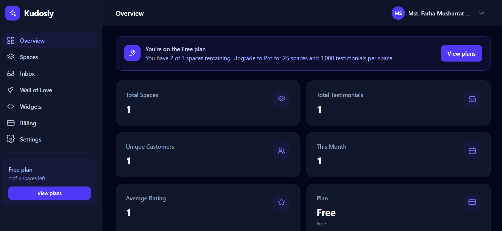

**Overview — submissions chart and plan usage** — submissions per day over a
7, 30 or 90 day window, alongside space and testimonial usage meters and the
most recent submissions.

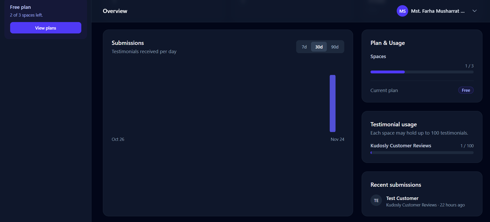

### Spaces

**Space list** — the account's spaces with their theme, testimonial count,
publish toggle, and the edit, delete, copy-URL and view-page actions.

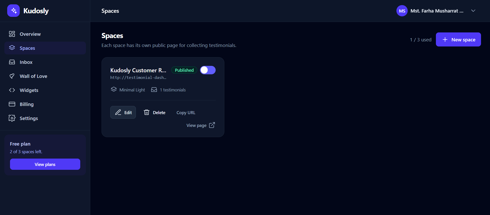

**Create a space — details** — the name, headline, sub-headline, testimonial
request and theme picker on the space creation form.

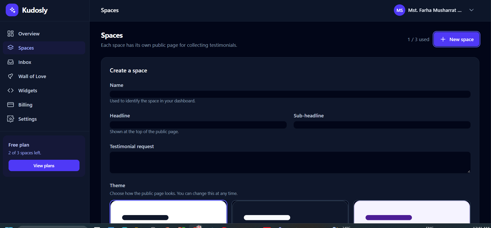

**Create a space — theme** — the three available themes (Minimal Light,
Modern Dark, Soft Gradient) and the optional star-rating toggle.

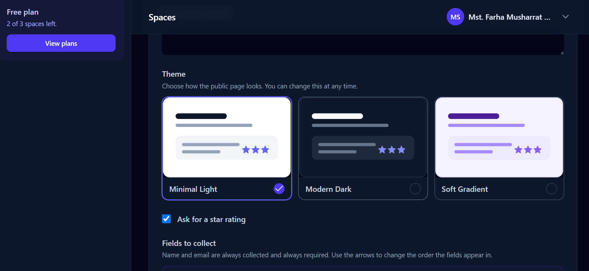

**Create a space — custom fields** — the fields to collect, each with an
"always on" / "collect" toggle, an optional "required" toggle, and arrow
controls for reordering.

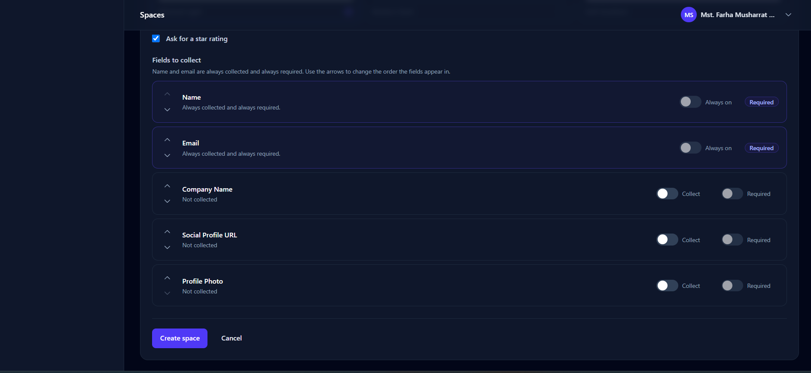

### Public collection page

**Public testimonial form** — the customer-facing page at `/s/{slug}/submit`,
showing the space's theme, the custom questions, the rating, the consent
checkbox and the submit button. No account is required to reach it.


### Moderation

**Inbox** — the moderation queue with search, status and space filters, and
the approve, hide, favourite, add-to-wall and delete actions on each
testimonial.

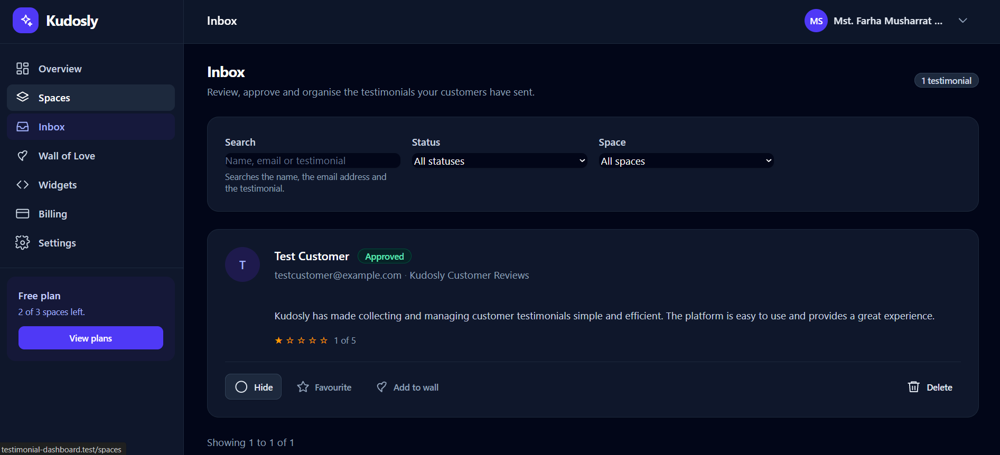

### Wall of Love

**Wall management** — the space's wall with its publish toggle, the count of
testimonials currently on the wall, the number eligible to add, and the
"choose testimonials", "copy link" and "view wall" actions.

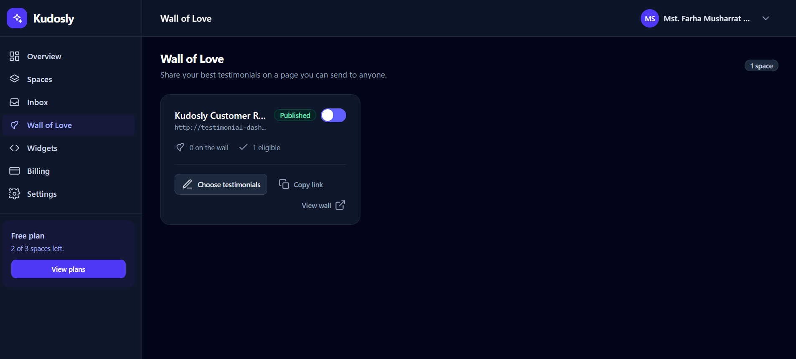

**Public wall** — the shared wall at `/wall/{slug}`, rendering the testimonial
with its rating and the customer's name only.

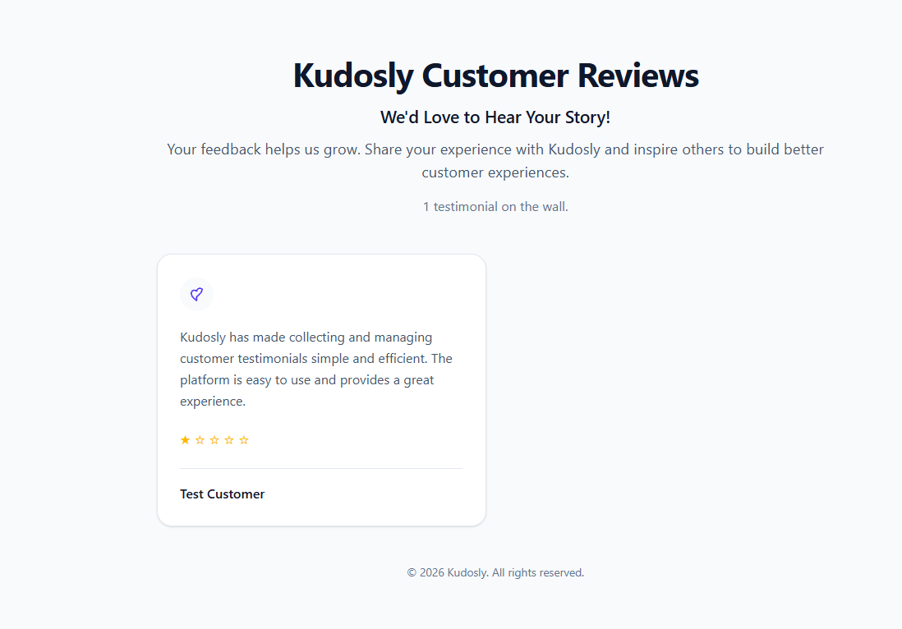

### Widgets

**Widget builder** — the space selector, layout and theme choices, background
colour picker, display limit and animation toggle, with a live preview pane.

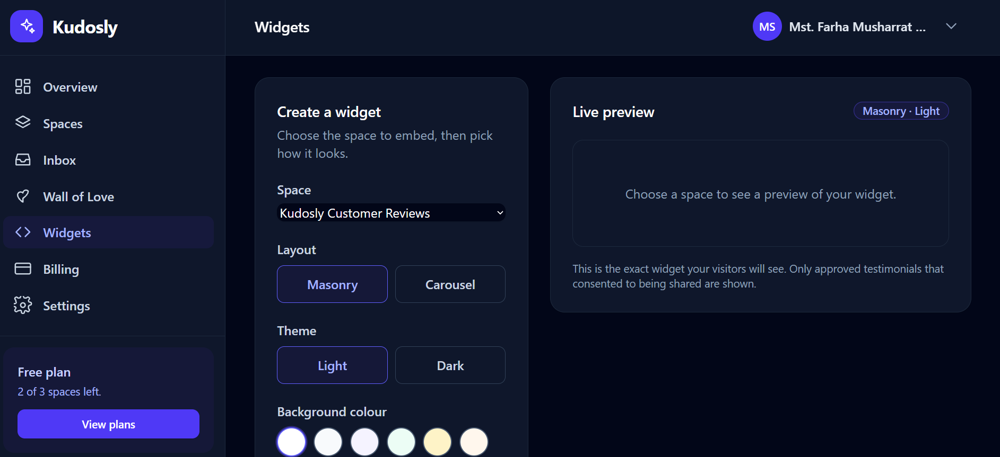

**Widget builder — preview settings** — the lower half of the builder, showing
the background colour field, the "testimonials to show" limit and the create
action.

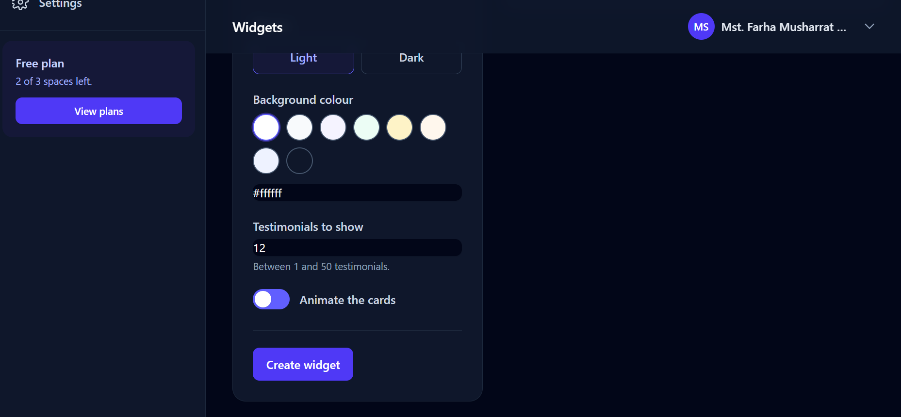

### Billing

**Billing — current plan and usage** — the plan card with space and
testimonial usage meters, and the billing actions panel.

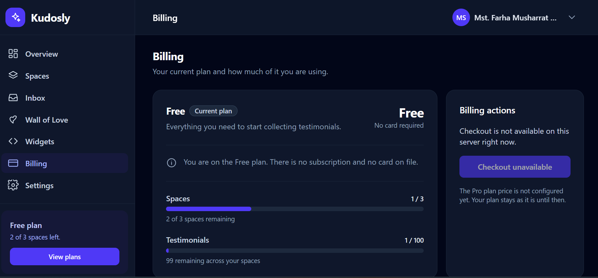

**Billing — plan comparison** — the Free and Pro plans side by side with
their allowances, and the per-space testimonial usage for the current plan.

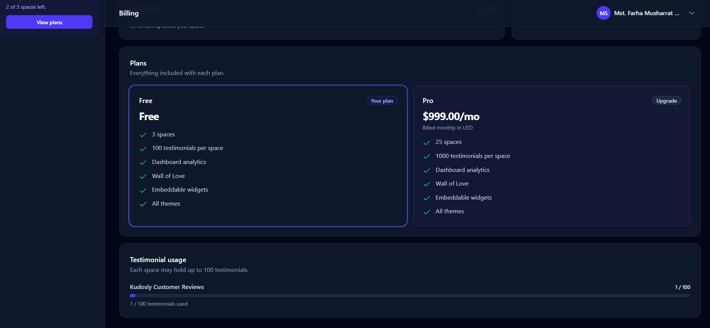

### Settings

**Settings** — the profile information form, the password form, and the
account summary showing the current plan, email verification state and spaces
used.

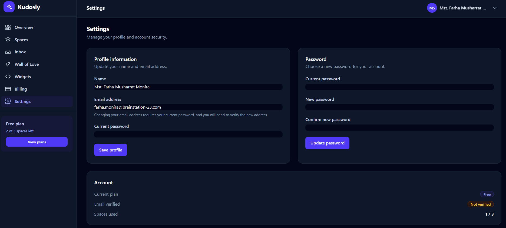

### Not yet captured

The following views exist in the application but have not been captured yet:

| View | Status |
| --- | --- |
| Thank-you page after a testimonial is submitted | ⬜ Not captured |
| Embedded widget rendered on a third-party host page | ⬜ Not captured |
| Password reset request and reset forms | ⬜ Not captured |

---

## Project Reflection

A personal reflection on the development process, the technical decisions, and
the lessons learned while building Kudosly is available in
[`docs/REFLECTION.md`](docs/REFLECTION.md).

---

## Project Purpose

Kudosly is a testimonial collection and management platform designed to help
businesses collect, manage, and showcase customer feedback.

It is not released under an open-source licence, and no licence is granted for
reuse, redistribution or commercial use. The repository is published for
review purposes only, and the accompanying `PRD.md` remains
the property of its author.
